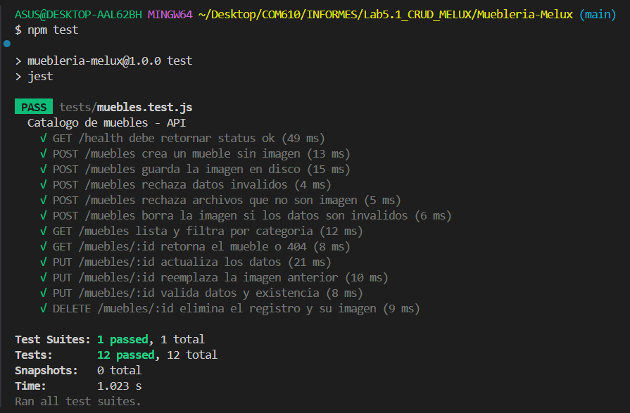

# Laboratorio 5.1: Creación de un Workflow de GitHub Actions para CI

**Universidad San Francisco Xavier de Chuquisaca**

**Asignatura:** Trabajando en la Nube (COM610)

**Estudiante:** Edgar Tito Gonzales

**Docente:** Ing. Marcelo Quispe Ortega

**Semestre:** 2/2026

---

## Introducción

La **Integración Continua (CI)** consiste en verificar automáticamente cada cambio que se sube a un repositorio: se instalan las dependencias, se revisa la calidad del código y se ejecutan las pruebas en un entorno limpio, de modo que los errores se detectan en minutos y no al momento de desplegar. **GitHub Actions** implementa CI mediante *workflows* escritos en YAML dentro de `.github/workflows/`, que se disparan con eventos como `push` o `pull_request`. Recuerda que YAML distingue la **indentación** (usar 2 espacios, nunca tabulaciones).

En esta práctica individual se construye una **API CRUD para un catálogo de muebles** (Express + SQLite + subida de imágenes) y se le agrega, de forma progresiva, un pipeline de CI completo: pruebas, linting, matriz de versiones de Node.js, reporte de cobertura y una regla de protección de rama que impide fusionar código que no pase el pipeline.

## 🎯 Objetivos del Laboratorio

- **Desarrollar** una API CRUD con base de datos e imágenes, con pruebas automatizadas.
- **Crear y evolucionar** un workflow `.github/workflows/ci.yml` (básico → linting → matriz + cobertura).
- **Interpretar** las ejecuciones exitosas y fallidas en la pestaña **Actions**.
- **Generar** un reporte de cobertura y conservarlo como artefacto del workflow.
- **Proteger** la rama `main` exigiendo que el CI pase antes de permitir un *merge*.
- **Comprobar** el flujo completo con una *pull request* que primero es bloqueada y luego aprobada.

## 🧰 Resumen del proyecto

| Elemento | Detalle |
|---|---|
| Aplicación | API REST de catálogo de muebles |
| Tecnologías | Node.js, Express 5, SQLite (`better-sqlite3`), `multer` (imágenes) |
| Pruebas | Jest + Supertest |
| Linting | ESLint (flat config) |
| CI | GitHub Actions (matriz Node.js 22 y 24) |

**Endpoints:**

| Método | Ruta | Descripción |
|---|---|---|
| `GET` | `/health` | Estado del servicio |
| `POST` | `/muebles` | Crea un mueble (formulario `multipart`, imagen opcional) |
| `GET` | `/muebles` | Lista muebles (filtro opcional `?categoria=`) |
| `GET` | `/muebles/:id` | Obtiene un mueble |
| `PUT` | `/muebles/:id` | Actualiza un mueble (y opcionalmente reemplaza su imagen) |
| `DELETE` | `/muebles/:id` | Elimina el mueble y su imagen |
| `GET` | `/uploads/<archivo>` | Sirve las imágenes subidas |

> **Nota sobre versiones:** `better-sqlite3` (versión 13) requiere **Node.js 22 o superior**, por eso la matriz del pipeline usa las versiones 22 y 24 en lugar de 18 y 20.

---

## 🏗️ Sección 4: Práctica Individual — "CI para el Catálogo de Muebles" (Parte calificativa)

> **Antes de empezar:** verifica las herramientas instaladas.
> ```bash
> node -v
> npm -v
> git --version
> ```
> **Resultado esperado:** Node.js `v22.x` o superior, npm `10.x` o superior y Git instalado.

### Ejercicio 1: Repositorio y aplicación CRUD con pruebas

**1. Crear el repositorio en GitHub:** nuevo repositorio **público** llamado `catalogo-muebles-ci` (sin README, sin `.gitignore`).

> Usa un repositorio público: en cuentas gratuitas, las reglas de protección de rama **no se aplican** a repositorios privados.

**2. Clonarlo e inicializar el proyecto:**
```bash
cd ~
git clone https://github.com/TU_USUARIO/catalogo-muebles-ci.git
cd catalogo-muebles-ci
npm init -y
npm install express multer better-sqlite3
npm install --save-dev jest supertest
mkdir -p src tests uploads img
touch uploads/.gitkeep
```
**Verificación:**
```bash
ls -la
```
**Resultado esperado:** se listan `package.json`, `package-lock.json`, `node_modules`, `src`, `tests`, `uploads` e `img`.

**3. Crear el `.gitignore`:**
```bash
cat > .gitignore << 'EOF'
node_modules/
.env
coverage/
catalogo.db
uploads/*
!uploads/.gitkeep
EOF
```

**4. Crear `src/db.js` (conexión y tabla de SQLite):**
```bash
cat > src/db.js << 'EOF'
const Database = require('better-sqlite3');

function createDb(file = process.env.DB_FILE || 'catalogo.db') {
  const db = new Database(file);
  db.exec(`CREATE TABLE IF NOT EXISTS muebles (
    id INTEGER PRIMARY KEY AUTOINCREMENT,
    nombre TEXT NOT NULL,
    categoria TEXT NOT NULL,
    precio REAL NOT NULL CHECK (precio >= 0),
    stock INTEGER NOT NULL DEFAULT 0,
    imagen TEXT
  )`);
  return db;
}

module.exports = { createDb };
EOF
```

**5. Crear `src/app.js` (rutas del CRUD y subida de imágenes):**
```bash
cat > src/app.js << 'EOF'
const express = require('express');
const multer = require('multer');
const path = require('path');
const fs = require('fs');

const TIPOS_PERMITIDOS = ['image/jpeg', 'image/png', 'image/webp'];

function parsear(body) {
  const nombre = String(body.nombre ?? '').trim();
  const categoria = String(body.categoria ?? '').trim();
  const precio = body.precio === undefined || body.precio === '' ? NaN : Number(body.precio);
  const stock = body.stock === undefined || body.stock === '' ? 0 : Number(body.stock);

  const errores = [];
  if (!nombre) errores.push('nombre es requerido');
  if (!categoria) errores.push('categoria es requerida');
  if (!Number.isFinite(precio) || precio < 0) errores.push('precio debe ser un numero mayor o igual a 0');
  if (!Number.isInteger(stock) || stock < 0) errores.push('stock debe ser un entero mayor o igual a 0');

  return { datos: { nombre, categoria, precio, stock }, errores };
}

function createApp(db, uploadDir = path.join(__dirname, '..', 'uploads')) {
  fs.mkdirSync(uploadDir, { recursive: true });

  const upload = multer({
    storage: multer.diskStorage({
      destination: (req, file, cb) => cb(null, uploadDir),
      filename: (req, file, cb) => {
        const ext = path.extname(file.originalname).toLowerCase();
        cb(null, `${Date.now()}-${Math.round(Math.random() * 1e9)}${ext}`);
      },
    }),
    limits: { fileSize: 2 * 1024 * 1024 },
    fileFilter: (req, file, cb) => {
      if (TIPOS_PERMITIDOS.includes(file.mimetype)) return cb(null, true);
      cb(new Error('Solo se permiten imagenes JPG, PNG o WEBP'));
    },
  });

  const app = express();
  app.use(express.json());
  app.use('/uploads', express.static(uploadDir));

  const conUrl = (fila) =>
    fila && { ...fila, imagen_url: fila.imagen ? `/uploads/${fila.imagen}` : null };
  const buscar = (id) => conUrl(db.prepare('SELECT * FROM muebles WHERE id = ?').get(id));
  const borrarImagen = (archivo) => {
    if (archivo) fs.rmSync(path.join(uploadDir, archivo), { force: true });
  };

  app.get('/health', (req, res) => {
    res.status(200).json({ status: 'ok' });
  });

  // CREATE
  app.post('/muebles', upload.single('imagen'), (req, res) => {
    const { datos, errores } = parsear(req.body || {});
    if (errores.length) {
      if (req.file) borrarImagen(req.file.filename);
      return res.status(400).json({ errores });
    }
    const imagen = req.file ? req.file.filename : null;
    const info = db
      .prepare('INSERT INTO muebles (nombre, categoria, precio, stock, imagen) VALUES (?, ?, ?, ?, ?)')
      .run(datos.nombre, datos.categoria, datos.precio, datos.stock, imagen);
    res.status(201).json(buscar(info.lastInsertRowid));
  });

  // READ (todos)
  app.get('/muebles', (req, res) => {
    const { categoria } = req.query;
    const filas = categoria
      ? db.prepare('SELECT * FROM muebles WHERE categoria = ? ORDER BY id').all(categoria)
      : db.prepare('SELECT * FROM muebles ORDER BY id').all();
    res.json(filas.map(conUrl));
  });

  // READ (uno)
  app.get('/muebles/:id', (req, res) => {
    const mueble = buscar(req.params.id);
    if (!mueble) return res.status(404).json({ error: 'Mueble no encontrado' });
    res.json(mueble);
  });

  // UPDATE
  app.put('/muebles/:id', upload.single('imagen'), (req, res) => {
    const actual = buscar(req.params.id);
    if (!actual) {
      if (req.file) borrarImagen(req.file.filename);
      return res.status(404).json({ error: 'Mueble no encontrado' });
    }
    const { datos, errores } = parsear(req.body || {});
    if (errores.length) {
      if (req.file) borrarImagen(req.file.filename);
      return res.status(400).json({ errores });
    }
    const imagen = req.file ? req.file.filename : actual.imagen;
    db.prepare('UPDATE muebles SET nombre = ?, categoria = ?, precio = ?, stock = ?, imagen = ? WHERE id = ?')
      .run(datos.nombre, datos.categoria, datos.precio, datos.stock, imagen, req.params.id);
    if (req.file) borrarImagen(actual.imagen);
    res.json(buscar(req.params.id));
  });

  // DELETE
  app.delete('/muebles/:id', (req, res) => {
    const actual = buscar(req.params.id);
    if (!actual) return res.status(404).json({ error: 'Mueble no encontrado' });
    db.prepare('DELETE FROM muebles WHERE id = ?').run(req.params.id);
    borrarImagen(actual.imagen);
    res.json({ mensaje: 'Mueble eliminado' });
  });

  // Manejo de errores (incluye los de multer)
  app.use((err, req, res, _next) => {
    if (err instanceof multer.MulterError || err.message.startsWith('Solo se permiten')) {
      return res.status(400).json({ error: err.message });
    }
    console.error(err);
    res.status(500).json({ error: 'Error interno del servidor' });
  });

  return app;
}

module.exports = { createApp };
EOF
```
- `createApp(db, uploadDir)` recibe la base de datos y la carpeta de imágenes como parámetros: así las pruebas pueden usar una base **en memoria** y una carpeta temporal, sin ensuciar el proyecto.
- Al actualizar o eliminar un mueble, la imagen anterior se borra del disco para no dejar archivos huérfanos.

**6. Crear `src/server.js` (arranque del servidor):**
```bash
cat > src/server.js << 'EOF'
const { createDb } = require('./db');
const { createApp } = require('./app');

const PORT = process.env.PORT || 3000;
const app = createApp(createDb());

app.listen(PORT, () => {
  console.log(`Catalogo de muebles escuchando en el puerto ${PORT}`);
});
EOF
```

**7. Crear las pruebas `tests/muebles.test.js`:**
```bash
cat > tests/muebles.test.js << 'EOF'
const request = require('supertest');
const fs = require('fs');
const os = require('os');
const path = require('path');
const { createDb } = require('../src/db');
const { createApp } = require('../src/app');

let db;
let app;
let uploadDir;

const PNG = Buffer.from('imagen-falsa-para-pruebas');

function crearMueble(datos = {}, conImagen = false) {
  const base = { nombre: 'Silla Nordica', categoria: 'Sillas', precio: '350.5', stock: '4', ...datos };
  let req = request(app).post('/muebles');
  Object.entries(base).forEach(([k, v]) => {
    req = req.field(k, v);
  });
  if (conImagen) req = req.attach('imagen', PNG, { filename: 'silla.png', contentType: 'image/png' });
  return req;
}

beforeEach(() => {
  db = createDb(':memory:');
  uploadDir = fs.mkdtempSync(path.join(os.tmpdir(), 'muebles-'));
  app = createApp(db, uploadDir);
});

afterEach(() => {
  db.close();
  fs.rmSync(uploadDir, { recursive: true, force: true });
});

describe('Catalogo de muebles - API', () => {
  test('GET /health debe retornar status ok', async () => {
    const res = await request(app).get('/health');
    expect(res.statusCode).toBe(200);
    expect(res.body.status).toBe('ok');
  });

  test('POST /muebles crea un mueble sin imagen', async () => {
    const res = await crearMueble();
    expect(res.statusCode).toBe(201);
    expect(res.body).toMatchObject({ id: 1, nombre: 'Silla Nordica', precio: 350.5, stock: 4, imagen_url: null });
  });

  test('POST /muebles guarda la imagen en disco', async () => {
    const res = await crearMueble({}, true);
    expect(res.statusCode).toBe(201);
    expect(res.body.imagen_url).toMatch(/^\/uploads\/.+\.png$/);
    expect(fs.existsSync(path.join(uploadDir, res.body.imagen))).toBe(true);
    const img = await request(app).get(res.body.imagen_url);
    expect(img.statusCode).toBe(200);
  });

  test('POST /muebles rechaza datos invalidos', async () => {
    const res = await crearMueble({ nombre: '', precio: '-5' });
    expect(res.statusCode).toBe(400);
    expect(res.body.errores.length).toBe(2);
  });

  test('POST /muebles rechaza archivos que no son imagen', async () => {
    const res = await request(app)
      .post('/muebles')
      .field('nombre', 'Mesa')
      .field('categoria', 'Mesas')
      .field('precio', '100')
      .attach('imagen', Buffer.from('hola'), { filename: 'nota.txt', contentType: 'text/plain' });
    expect(res.statusCode).toBe(400);
    expect(fs.readdirSync(uploadDir).length).toBe(0);
  });

  test('POST /muebles borra la imagen si los datos son invalidos', async () => {
    const res = await crearMueble({ precio: 'abc' }, true);
    expect(res.statusCode).toBe(400);
    expect(fs.readdirSync(uploadDir).length).toBe(0);
  });

  test('GET /muebles lista y filtra por categoria', async () => {
    await crearMueble();
    await crearMueble({ nombre: 'Mesa Roble', categoria: 'Mesas', precio: '900' });
    const todos = await request(app).get('/muebles');
    expect(todos.body.length).toBe(2);
    const mesas = await request(app).get('/muebles?categoria=Mesas');
    expect(mesas.body.length).toBe(1);
    expect(mesas.body[0].nombre).toBe('Mesa Roble');
  });

  test('GET /muebles/:id retorna el mueble o 404', async () => {
    await crearMueble();
    const ok = await request(app).get('/muebles/1');
    expect(ok.statusCode).toBe(200);
    expect(ok.body.nombre).toBe('Silla Nordica');
    const no = await request(app).get('/muebles/99');
    expect(no.statusCode).toBe(404);
  });

  test('PUT /muebles/:id actualiza los datos', async () => {
    await crearMueble();
    const res = await request(app)
      .put('/muebles/1')
      .send({ nombre: 'Silla Premium', categoria: 'Sillas', precio: 420, stock: 10 });
    expect(res.statusCode).toBe(200);
    expect(res.body).toMatchObject({ nombre: 'Silla Premium', precio: 420, stock: 10 });
  });

  test('PUT /muebles/:id reemplaza la imagen anterior', async () => {
    const creado = await crearMueble({}, true);
    const res = await request(app)
      .put('/muebles/1')
      .field('nombre', 'Silla Nordica')
      .field('categoria', 'Sillas')
      .field('precio', '350.5')
      .attach('imagen', PNG, { filename: 'nueva.png', contentType: 'image/png' });
    expect(res.statusCode).toBe(200);
    expect(res.body.imagen).not.toBe(creado.body.imagen);
    expect(fs.existsSync(path.join(uploadDir, creado.body.imagen))).toBe(false);
    expect(fs.readdirSync(uploadDir).length).toBe(1);
  });

  test('PUT /muebles/:id valida datos y existencia', async () => {
    await crearMueble();
    const invalido = await request(app).put('/muebles/1').send({ nombre: '' });
    expect(invalido.statusCode).toBe(400);
    const noExiste = await request(app)
      .put('/muebles/99')
      .send({ nombre: 'X', categoria: 'Y', precio: 1 });
    expect(noExiste.statusCode).toBe(404);
  });

  test('DELETE /muebles/:id elimina el registro y su imagen', async () => {
    const creado = await crearMueble({}, true);
    const res = await request(app).delete('/muebles/1');
    expect(res.statusCode).toBe(200);
    expect(fs.existsSync(path.join(uploadDir, creado.body.imagen))).toBe(false);
    const otra = await request(app).delete('/muebles/1');
    expect(otra.statusCode).toBe(404);
  });
});
EOF
```

**8. Configurar los scripts de `package.json`:**
```bash
npm pkg set main=src/server.js
npm pkg set scripts.start="node src/server.js"
npm pkg set scripts.test="jest"
```
**Verificación:**
```bash
cat package.json
```
**Resultado esperado:** el JSON muestra `"main": "src/server.js"`, los scripts `start` y `test`, y las dependencias `express`, `multer`, `better-sqlite3`, `jest` y `supertest`.

**9. Ejecutar las pruebas localmente:**
```bash
npm test
```
**Resultado esperado:** `Tests: 12 passed, 12 total`.


> Descripción sugerida: "Se observa la salida de `npm test` con las 12 pruebas del catálogo de muebles aprobadas, antes de configurar el pipeline de CI."

**10. Probar el CRUD manualmente (con imagen):** en una terminal inicia el servidor y en otra ejecuta las peticiones. Usa cualquier imagen `.jpg` que tengas (aquí `silla.jpg`).
```bash
npm start
```
```bash
# Crear (con imagen)
curl -X POST http://localhost:3000/muebles \
  -F "nombre=Silla Nordica" \
  -F "categoria=Sillas" \
  -F "precio=350.5" \
  -F "stock=4" \
  -F "imagen=@./img/silla.jpg;type=image/jpeg"

# Leer
curl http://localhost:3000/muebles
curl http://localhost:3000/muebles/1

# Actualizar
curl -X PUT http://localhost:3000/muebles/1 -H "Content-Type: application/json" \
  -d '{
    "nombre":"Silla Nordica Premium",
    "categoria":"Sillas",
    "precio":420,
    "stock":10}'

# Eliminar
curl -X DELETE http://localhost:3000/muebles/1
```
**Verificación:**
```bash
ls uploads
```
**Resultado esperado:** la creación responde `201` con un campo `imagen_url` del tipo `/uploads/<archivo>.jpg`; el archivo aparece en `uploads/` y, tras el `DELETE`, desaparece. Detén el servidor con `Ctrl + C`.


> Descripción sugerida: "Se observan las peticiones `curl` de creación (con imagen), lectura, actualización y borrado sobre `http://localhost:3000/muebles`, con sus respuestas."

**11. Primer commit (incluye `package-lock.json`, indispensable para `npm ci`):**
```bash
git add .
git commit -m "feat: api crud de catalogo de muebles con sqlite e imagenes"
git push origin main
```
**Verificación:**
```bash
git status
git log --oneline
```
**Resultado esperado:** `nothing to commit, working tree clean` y el commit listado.

---

### Ejercicio 2: Workflow de CI básico

**1. Crear la carpeta y el archivo del workflow:**
```bash
mkdir -p .github/workflows
cat > .github/workflows/ci.yml << 'EOF'
name: CI Basico

on:
  push:
    branches: [main]
  pull_request:
    branches: [main]

jobs:
  build-and-test:
    runs-on: ubuntu-latest

    steps:
      - name: Checkout del codigo
        uses: actions/checkout@v6

      - name: Configurar Node.js
        uses: actions/setup-node@v6
        with:
          node-version: '22'

      - name: Instalar dependencias
        run: npm ci

      - name: Ejecutar pruebas
        run: npm test
EOF
```
- `on`: el workflow se dispara con cada `push` a `main` y con cada *pull request* hacia `main`.
- `npm ci` instala exactamente las versiones de `package-lock.json` (más rápido y reproducible que `npm install`).

**2. Subir el workflow:**
```bash
git add .github/workflows/ci.yml
git commit -m "ci: agrega workflow basico de integracion continua"
git push origin main
```
**Verificación:** abrir la pestaña **Actions** del repositorio.

**Resultado esperado:** aparece la ejecución `CI Basico` en estado *en progreso* y luego con ✅. Al abrir el job `build-and-test` se ven los pasos *Checkout*, *Configurar Node.js*, *Instalar dependencias* y *Ejecutar pruebas* con sus logs.


> Descripción sugerida: "Se observa en la pestaña Actions la ejecución del workflow `CI Basico`, primero en proceso y luego completada con éxito, y el detalle del job `build-and-test` con los logs de cada paso, incluyendo `12 passed` en la ejecución de pruebas."

---

### Ejercicio 3: Linting y fallo intencional

**1. Instalar ESLint y crear su configuración:**
```bash
npm install --save-dev eslint @eslint/js globals
cat > eslint.config.js << 'EOF'
const js = require('@eslint/js');
const globals = require('globals');

module.exports = [
  js.configs.recommended,
  {
    files: ['**/*.js'],
    languageOptions: {
      ecmaVersion: 2022,
      sourceType: 'commonjs',
      globals: { ...globals.node, ...globals.jest },
    },
    rules: {
      'no-unused-vars': ['error', { argsIgnorePattern: '^_' }],
      eqeqeq: 'error',
      'prefer-const': 'error',
      'no-var': 'error',
    },
  },
  { ignores: ['node_modules/', 'coverage/', 'uploads/'] },
];
EOF
npm pkg set scripts.lint="eslint ."
```
**Verificación:**
```bash
npm run lint
```
**Resultado esperado:** el comando termina sin mostrar errores ni advertencias.


> Descripción sugerida: "Se observa el archivo `eslint.config.js` y la ejecución de `npm run lint` finalizando sin errores."

**2. Agregar el paso de linting al workflow (antes de las pruebas):**
```bash
cat > .github/workflows/ci.yml << 'EOF'
name: CI con Linting

on:
  push:
    branches: [main]
  pull_request:
    branches: [main]

jobs:
  build-and-test:
    runs-on: ubuntu-latest

    steps:
      - name: Checkout del codigo
        uses: actions/checkout@v6

      - name: Configurar Node.js
        uses: actions/setup-node@v6
        with:
          node-version: '22'

      - name: Instalar dependencias
        run: npm ci

      - name: Ejecutar linting
        run: npm run lint

      - name: Ejecutar pruebas
        run: npm test
EOF
git add .
git commit -m "ci: agrega eslint y paso de linting al pipeline"
git push origin main
```
**Resultado esperado:** en **Actions** la ejecución `CI con Linting` finaliza con ✅ y muestra el paso *Ejecutar linting* antes de *Ejecutar pruebas*.


**3. Forzar un fallo intencional:** agregar una variable sin usar al final de `src/app.js`.
```bash
echo "const unusedVariable = 'esto causara un error de linting';" >> src/app.js
npm run lint
```
**Resultado esperado (local):** ESLint reporta `'unusedVariable' is assigned a value but never used  no-unused-vars`.

```bash
git add src/app.js
git commit -m "test: fuerza un error de linting para probar el pipeline"
git push origin main
```
**Resultado esperado:** en **Actions** el workflow **falla** (❌) en el paso *Ejecutar linting* y el paso *Ejecutar pruebas* ni siquiera se ejecuta.


> Descripción sugerida: "Se observa en la pestaña Actions el workflow marcado con ❌ y, en el detalle del job, el paso *Ejecutar linting* en rojo con el error `no-unused-vars`, mientras que *Ejecutar pruebas* aparece omitido."

**4. Revertir el error:**
```bash
git revert HEAD --no-edit
git push origin main
```
**Resultado esperado:** se crea un commit `Revert "test: fuerza un error de linting..."` y el workflow vuelve a pasar con ✅.


> Descripción sugerida: "Se observa el historial de ejecuciones en Actions con la secuencia: ejecución exitosa, ejecución fallida por linting y ejecución exitosa tras el `git revert`."

---

### Ejercicio 4: Pipeline completo — matriz, build, cobertura y artefacto

**1. Configurar Jest para medir cobertura con un umbral mínimo:**
```bash
cat > jest.config.js << 'EOF'
module.exports = {
  testEnvironment: 'node',
  collectCoverageFrom: ['src/**/*.js', '!src/server.js'],
  coverageReporters: ['text', 'text-summary', 'lcov'],
  coverageThreshold: {
    global: { statements: 80, branches: 70, functions: 80, lines: 80 },
  },
};
EOF
npm pkg set scripts.test:coverage="jest --coverage"
```
- Si la cobertura global baja de los umbrales, `jest --coverage` termina con error y **el pipeline falla**.

**Verificación:**
```bash
npm run test:coverage
```
**Resultado esperado:** una tabla de cobertura (con valores cercanos a `94 %` en sentencias, `82 %` en ramas, `100 %` en funciones y `97 %` en líneas), `Tests: 12 passed` y código de salida `0`.


> Descripción sugerida: "Se observa la salida de `npm run test:coverage` con la tabla de cobertura por archivo (`app.js`, `db.js`) y el resumen global superando los umbrales configurados."

**2. Reemplazar el workflow por la versión completa:**
```bash
cat > .github/workflows/ci.yml << 'EOF'
name: CI Catalogo de Muebles

on:
  push:
    branches: [main]
  pull_request:
    branches: [main]

jobs:
  build-and-test:
    name: Lint y pruebas (Node ${{ matrix.node-version }})
    runs-on: ubuntu-latest

    strategy:
      fail-fast: false
      matrix:
        node-version: [22, 24]

    steps:
      - name: Checkout del codigo
        uses: actions/checkout@v6

      - name: Configurar Node.js ${{ matrix.node-version }}
        uses: actions/setup-node@v6
        with:
          node-version: ${{ matrix.node-version }}
          cache: npm

      - name: Instalar dependencias
        run: npm ci

      - name: Verificar que los modulos cargan (build)
        run: node -e "require('./src/app'); require('./src/db'); console.log('Modulos cargados correctamente')"

      - name: Ejecutar linting
        run: npm run lint

      - name: Ejecutar pruebas con cobertura
        run: npm run test:coverage

      - name: Publicar reporte de cobertura
        if: always()
        uses: actions/upload-artifact@v4
        with:
          name: coverage-node-${{ matrix.node-version }}
          path: coverage/
EOF
git add .
git commit -m "ci: matriz de node, cobertura y artefacto de reporte"
git push origin main
```
- `matrix.node-version`: genera **dos jobs en paralelo** (Node 22 y 24) a partir de una sola definición.
- `fail-fast: false`: si una versión falla, la otra termina igualmente, lo que permite ver el resultado de ambas.
- `name: Lint y pruebas (Node ${{ matrix.node-version }})`: define el nombre visible de cada job; **ese nombre es el que se selecciona como check obligatorio** en la regla de protección de rama.
- *Compilación/build*: JavaScript no requiere compilación, por lo que esta etapa se reemplaza por una verificación de que los módulos de la aplicación cargan sin errores.
- `cache: npm`: reutiliza la caché de dependencias entre ejecuciones.
- `if: always()` en la subida del artefacto: el reporte se conserva incluso si las pruebas fallan.

**Resultado esperado:** en **Actions** aparece la ejecución `CI Catalogo de Muebles` con **dos jobs en paralelo** (`Lint y pruebas (Node 22)` y `Lint y pruebas (Node 24)`) en ✅, y al final de la página de la ejecución una sección **Artifacts** con `coverage-node-22` y `coverage-node-24`.


> Descripción sugerida: "Se observa la ejecución exitosa del workflow completo con los dos jobs de la matriz, el log del paso *Ejecutar pruebas con cobertura* mostrando la tabla de cobertura, y los artefactos `coverage-node-22` y `coverage-node-24` disponibles para descargar."

---

### Ejercicio 5: Regla de protección de rama

> Los *checks* obligatorios solo aparecen en la lista **después** de que el workflow se haya ejecutado al menos una vez en el repositorio (ya ocurrió en el ejercicio anterior).

**1. Crear la regla:** en GitHub ir a **Settings → Branches → Add branch protection rule** (o **Settings → Rules → Rulesets → New branch ruleset**) y configurar:

- **Branch name pattern:** `main`
- Activar **Require a pull request before merging** (opcional: **Require approvals** para exigir revisión de código).
- Activar **Require status checks to pass before merging** y, dentro, **Require branches to be up to date before merging**.
- En el buscador de checks, seleccionar **`Lint y pruebas (Node 22)`** y **`Lint y pruebas (Node 24)`**.
- Activar **Do not allow bypassing the above settings** (o *Include administrators*), para que la regla también se aplique al propietario del repositorio.
- Guardar con **Create / Save changes**.

**Verificación:** volver a **Settings → Branches** (o **Rules**).

**Resultado esperado:** la regla para `main` aparece listada y muestra los dos checks como obligatorios.


> Descripción sugerida: "Se observa la configuración de la regla de protección de la rama `main` con *Require status checks to pass before merging* activado y los checks `Lint y pruebas (Node 22)` y `Lint y pruebas (Node 24)` seleccionados como obligatorios."

---

### Ejercicio 6: Pull request bloqueada y luego aprobada

Se agregará una funcionalidad menor: filtrar muebles por **precio máximo** (`GET /muebles?precio_max=500`). Primero se sube con una prueba incorrecta a propósito, para comprobar que GitHub bloquea el *merge*.

**1. Crear la rama de feature:**
```bash
git pull origin main
git checkout -b feature/filtro-precio-maximo
```
**Verificación:**
```bash
git branch
```
**Resultado esperado:** `* feature/filtro-precio-maximo` marcada como rama activa.

**2. Implementar el filtro:** reemplazar en `src/app.js` el bloque de la ruta `GET /muebles` (el de `READ (todos)`) por esta versión:
```javascript
  // READ (todos)
  app.get('/muebles', (req, res) => {
    const { categoria, precio_max: precioMax } = req.query;
    const condiciones = [];
    const params = [];
    if (categoria) {
      condiciones.push('categoria = ?');
      params.push(categoria);
    }
    if (precioMax !== undefined) {
      const max = Number(precioMax);
      if (!Number.isFinite(max)) return res.status(400).json({ error: 'precio_max debe ser numerico' });
      condiciones.push('precio <= ?');
      params.push(max);
    }
    const where = condiciones.length ? `WHERE ${condiciones.join(' AND ')}` : '';
    const filas = db.prepare(`SELECT * FROM muebles ${where} ORDER BY id`).all(...params);
    res.json(filas.map(conUrl));
  });
```

**3. Agregar la prueba (con un error intencional):** insertar este bloque en `tests/muebles.test.js`, justo **antes** de la prueba `GET /muebles/:id retorna el mueble o 404`:
```javascript
  test('GET /muebles?precio_max filtra por precio maximo', async () => {
    await crearMueble({ nombre: 'Silla', precio: '200' });
    await crearMueble({ nombre: 'Sofa', categoria: 'Sofas', precio: '1500' });
    await crearMueble({ nombre: 'Mesa', categoria: 'Mesas', precio: '450' });
    const res = await request(app).get('/muebles?precio_max=500');
    expect(res.statusCode).toBe(200);
    expect(res.body.length).toBe(3); // ERROR INTENCIONAL: el valor correcto es 2
    const invalido = await request(app).get('/muebles?precio_max=abc');
    expect(invalido.statusCode).toBe(400);
  });

```
**Verificación local:**
```bash
npm test
```
**Resultado esperado:** `1 failed, 12 passed` (falla `expect(...).toBe(3)` porque solo 2 muebles cuestan 500 o menos).

**4. Subir la rama y crear la pull request:**
```bash
git add .
git commit -m "feat: agrega filtro por precio maximo (prueba con error intencional)"
git push -u origin feature/filtro-precio-maximo
```
En GitHub pulsar **Compare & pull request**, título `feat: filtro por precio máximo`, base `main` ← compare `feature/filtro-precio-maximo`, y **Create pull request**.

**Resultado esperado:** el workflow se ejecuta **automáticamente** sobre la PR, los checks `Lint y pruebas (Node 22/24)` fallan con ❌ y el botón de *merge* aparece **deshabilitado** con el mensaje *"Merging is blocked"* / *"Required statuses must pass before merging"*.


> Descripción sugerida: "Se observa la pull request con los checks obligatorios fallidos y el botón de merge bloqueado por la regla de protección de rama."

**5. Corregir el error:** cambiar `toBe(3)` por `toBe(2)` y eliminar el comentario del error intencional:
```bash
sed -i 's|toBe(3); // ERROR INTENCIONAL: el valor correcto es 2|toBe(2);|' tests/muebles.test.js
npm test
```
**Resultado esperado:** `Tests: 13 passed, 13 total`.

```bash
git add .
git commit -m "fix: corrige el valor esperado en la prueba del filtro"
git push
```
**Resultado esperado:** la PR se actualiza sola, el pipeline se vuelve a ejecutar y ambos checks pasan a ✅; el botón **Merge pull request** se habilita.


> Descripción sugerida: "Se observa la misma pull request tras el commit de corrección, con los dos checks en verde y el botón de merge habilitado."

**6. Fusionar la PR y actualizar el repositorio local:**
```bash
git checkout main
git pull origin main
git log --oneline
```
**Resultado esperado:** el historial de `main` incluye los commits de la feature y la ejecución posterior a la fusión aparece en **Actions** con ✅.


> Descripción sugerida: "Se observa el historial completo de ejecuciones en la pestaña Actions: workflow básico, con linting, fallo intencional, recuperación, matriz con cobertura, PR fallida, PR exitosa y ejecución tras el merge."

---

### Ejercicio 7: Documentación y entrega

**1. Crear el `README.md` con la sección de documentación:**
````bash
cat > README.md << 'EOF'
# Catálogo de Muebles — CI con GitHub Actions

API REST (Node.js + Express + SQLite) para gestionar un catálogo de muebles con imágenes,
con integración continua en GitHub Actions (linting, pruebas, cobertura y matriz de versiones).

## Ejecución local

```bash
npm ci
npm start        # http://localhost:3000
npm test
npm run lint
```

## Documentación del Laboratorio

Puedes encontrar el informe completo con capturas de pantalla y evidencias en el siguiente enlace:

- [Ver informe del laboratorio](./INFORME.md)
EOF
````

**2. Subir el informe y las capturas (carpeta `img/`):**
```bash
git add README.md INFORME.md img/
git commit -m "docs: agrega informe del laboratorio 5.1 y readme"
git push origin main

git checkout -b docs/informe-lab5-1
git push -u origin docs/informe-lab5-1

#despues se crea el pull request en github
```
> Como `main` está protegida, si GitHub rechaza el *push* directo, repite el flujo: rama `docs/informe` → *pull request* → esperar los checks → *merge*.

**Verificación:** abrir el repositorio en el navegador.

**Resultado esperado:** el `README.md` se muestra en la página principal con el enlace al informe, y `INFORME.md` se renderiza con todas las capturas.

---

## 📄 Conclusión Final

La integración continua convierte la verificación del código en un proceso automático, repetible y visible para todo el equipo. En este laboratorio, cada `push` y cada *pull request* ejecutan en un entorno limpio de GitHub la misma secuencia: instalar dependencias con `npm ci`, comprobar que la aplicación carga, analizar el código con ESLint y correr las pruebas con medición de cobertura. Esto elimina el clásico "en mi máquina funciona", porque el resultado no depende de la configuración local de quien programa.

La evolución del workflow mostró el valor de cada etapa. El **linting** detectó un error antes de ejecutar las pruebas y evitó gastar tiempo en un código que ya incumplía las reglas de calidad; el fallo intencional permitió comprobar, además, que el pipeline realmente protege y que un `git revert` devuelve el repositorio a un estado sano. La **matriz** de versiones de Node.js probó la misma aplicación en dos entornos en paralelo sin duplicar la configuración, y el **reporte de cobertura** —con un umbral mínimo que hace fallar el pipeline— dio una medida objetiva de qué tanto del código está respaldado por pruebas. Conservar ese reporte como artefacto permite revisarlo incluso cuando una ejecución falla.

Finalmente, la **regla de protección de rama** cerró el ciclo: de nada sirve un pipeline si se puede ignorar. Al exigir que los checks pasen antes del *merge*, la pull request con la prueba incorrecta quedó bloqueada hasta corregirse, lo que garantiza que `main` siempre contenga código verificado. En el contexto de un proyecto con base de datos e imágenes, como este catálogo de muebles, la CI es especialmente útil porque las pruebas validan también los casos delicados (archivos que no son imágenes, eliminación de imágenes huérfanas, datos inválidos) cada vez que se modifica el código, y es la base natural para el siguiente paso de una arquitectura en la nube: el despliegue continuo (CD).